# Healthier

[](https://github.com/cbukenya/healthier/actions/workflows/ci.yml)
[](LICENSE)

**Your Google Health data, made clear.** Healthier is an open-source dashboard you host yourself.
It covers the data your watch and phone collect: sleep, activity, heart rate, HRV, weight and
more. Every insight is plain arithmetic that you can trace back to your own numbers. Every formula
is open, for anyone to read and improve.

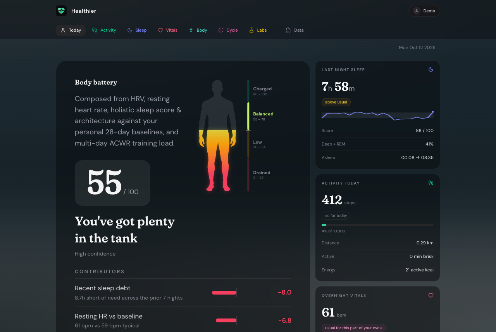

<p align="center">
  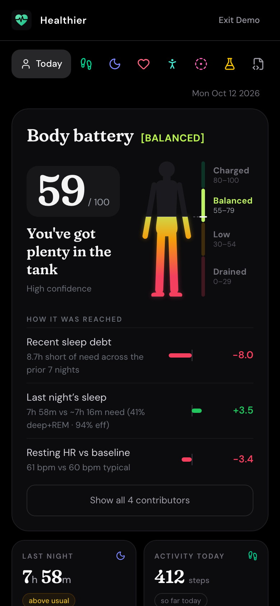
  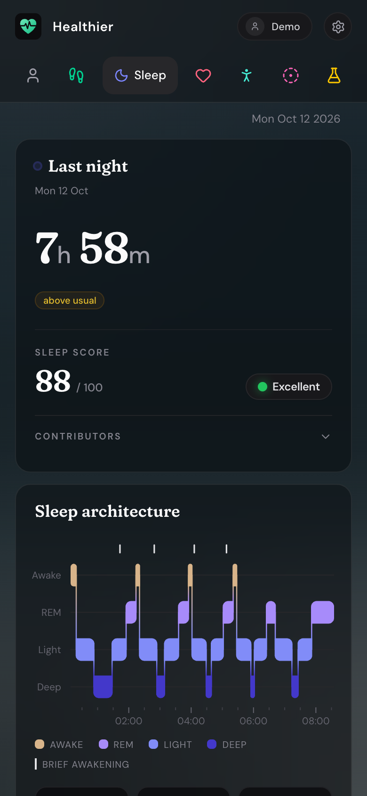
  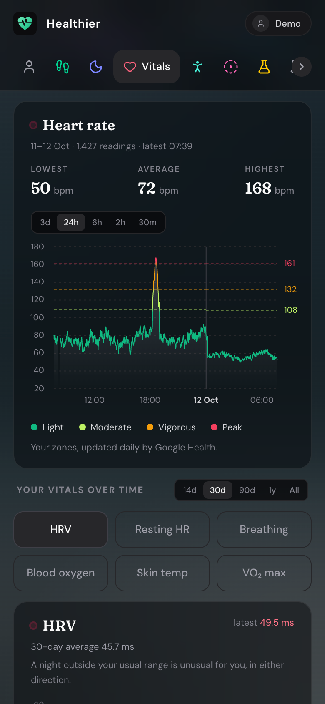
  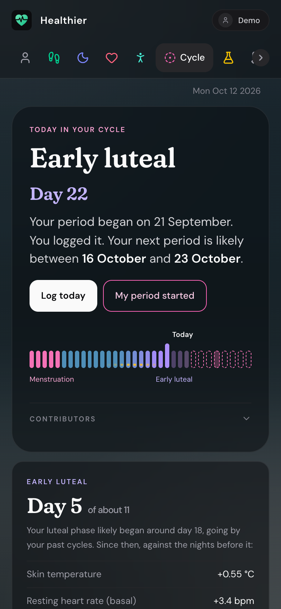
</p>
<p align="center"><sub>All screenshots are from demo mode: a year of made-up data, not a real person's.</sub></p>

> **Not a medical device.** Healthier is a personal wellness and data-visualisation tool. It does
> not diagnose, screen for, detect, monitor, prevent or treat any disease or condition, and it
> must not be used to make medical decisions. Its insights describe changes in your own data
> against your own usual ranges. If you have symptoms or concerns, talk to a clinician.

## Why Healthier

Healthier started because I found the Google Health app hard to read. All the data was there,
but it took too much digging to learn what it meant. These ideas guide the project:

**Clear before clever.** A glance should tell you how you slept, how much you've moved and how
you're recovering. Insights are plain sentences with the numbers inside them.

**Arithmetic you can trace.** Every score and insight is plain arithmetic on your own data. No AI
writes or guesses anything. The same data always gives the same answer, and every result can be
followed back to the readings behind it. For example, the body battery lists what raised and
lowered it, and each insight says what it compared.

**Open algorithms.** Most wearables give you a score without showing how they reached it. In
Healthier every formula is in the open, so anyone can check it, question it and improve it. The
goal is for the open-source community to build the best insights on fitness data, together.

**For everyone.** Many of the most polished health apps are iPhone-only, and Android users are left
waiting. Healthier runs in any browser, on a phone or a computer. It reads Google Health, which
Fitbit and Pixel watches, Android apps and Apple Health on the iPhone can all feed (see
[Getting your data in](#getting-your-data-in)).

**Labs: follow the data.** Labs are experiments on your own data. Each one looks for a pattern over
several weeks, such as:
- nights when breathing, oxygen and time awake shift together;
- how far your heart rate drops at night;
- stretches of fast heart rate while you sleep.

Some labs will start rough, and not every one will be scientifically robust at first. Out in the
open they can only get better, and anyone can propose a new one. Google's
[Health Guardian](https://blog.google/products-and-platforms/products/google-health/health-guardian-features-live/)
for Pixel Watch works in a similar spirit: it watches blood pressure, insulin resistance and sleep
breathing trends in the background, with Google's proprietary models. In Healthier, the
arithmetic behind every lab is open to read. Like the rest of Healthier, Labs don't detect,
screen for or rule out any condition.

**Yours.** You run it yourself, and it has no telemetry. Your Google tokens are encrypted in your
own database. Nothing leaves your server except requests to Google's API.

## A quick tour

Each page compares your numbers with your own usual ranges, and ends with insight cards: trends,
records from the past year, patterns, and nudges at the right time of day. A card shows in one
place at a time: on Today while it matters, otherwise on its own page.

<table>
  <tr>
    <td width="50%" valign="top">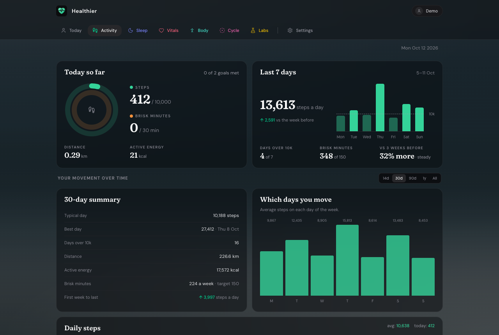<br><b>Activity.</b> Steps and brisk minutes against your goals and the WHO's 150 minutes a week. Energy, distance, intensity and weekly totals, from 14 days back to all your history.</td>
    <td width="50%" valign="top">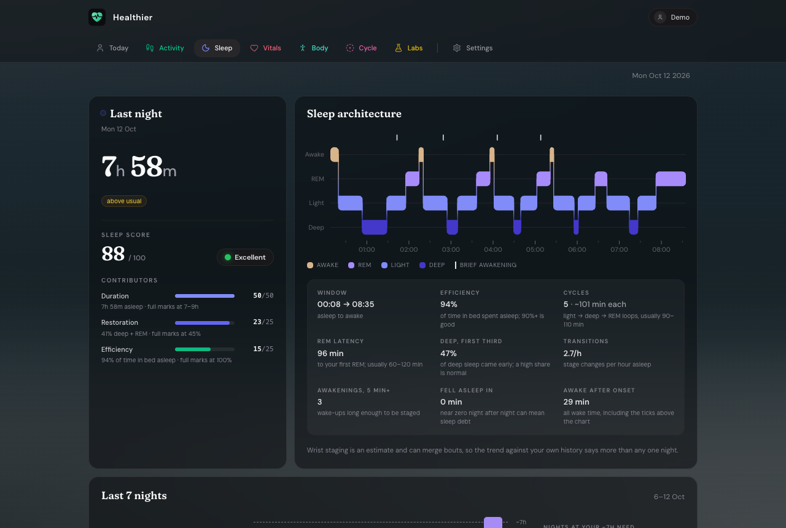<br><b>Sleep.</b> A sleep score with its parts and your stages through the night. Your sleep window across the month, regularity, naps, and sleep debt against your own need.</td>
  </tr>
  <tr>
    <td valign="top">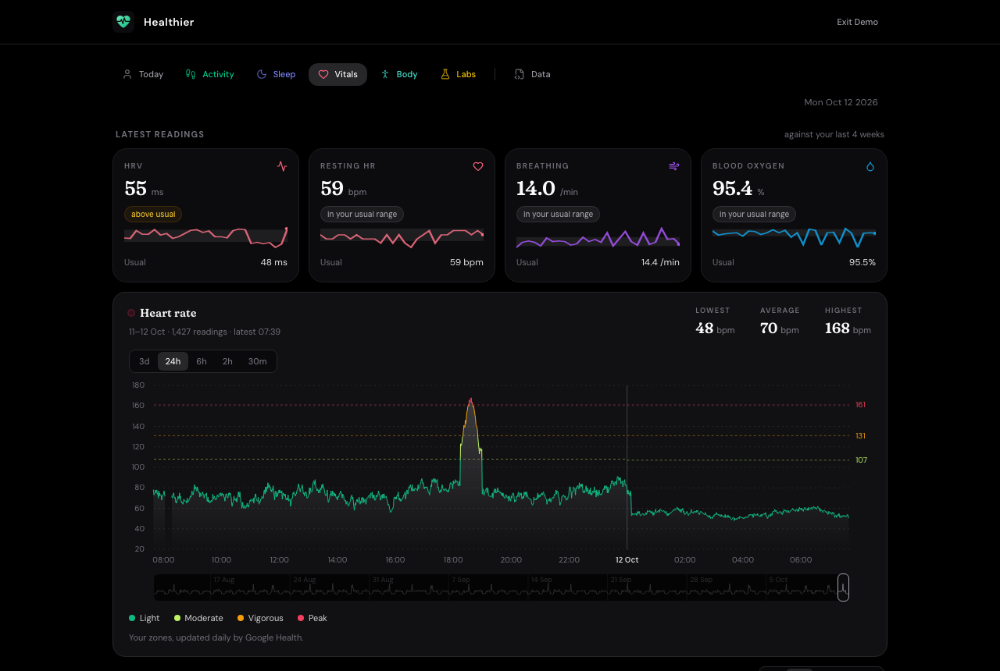<br><b>Vitals.</b> Heart rate minute by minute, with your zones. HRV, resting heart rate, breathing, blood oxygen, skin temperature and cardio fitness, each against your usual range.</td>
    <td valign="top">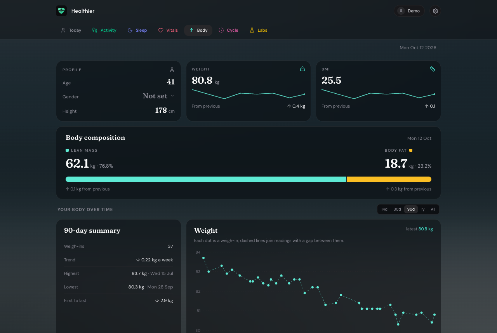<br><b>Body.</b> Your weight trend underneath the day-to-day swings, body fat and lean mass from a smart scale, and BMI.</td>
  </tr>
  <tr>
    <td valign="top">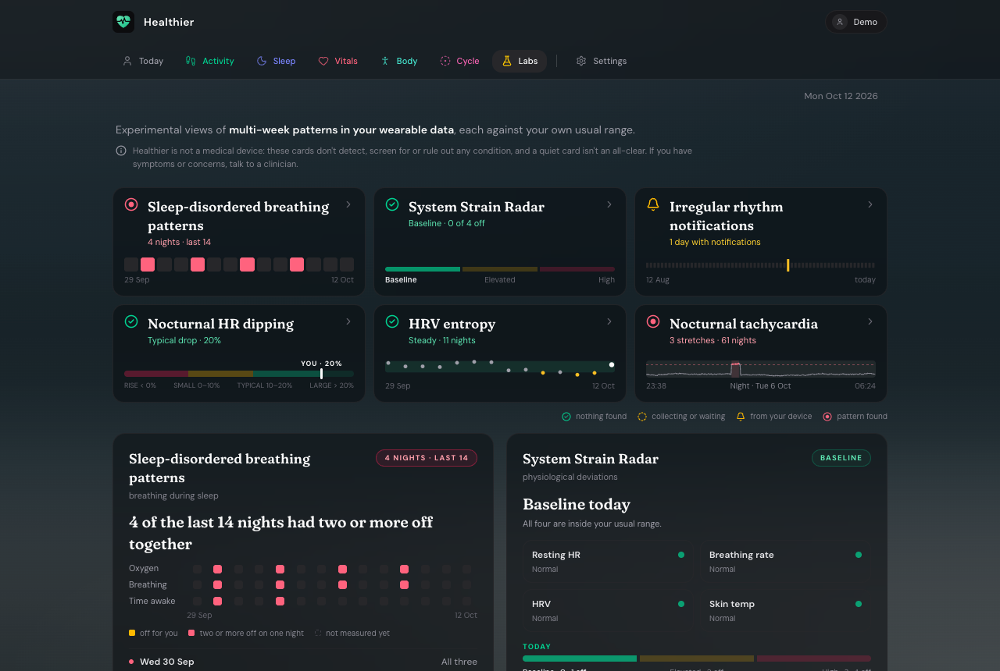<br><b>Labs.</b> Six experiments with multi-week patterns: breathing during sleep, signs of strain, irregular rhythm notifications from your device, heart rate dipping at night, HRV entropy, and fast heart rate during sleep.</td>
    <td valign="top">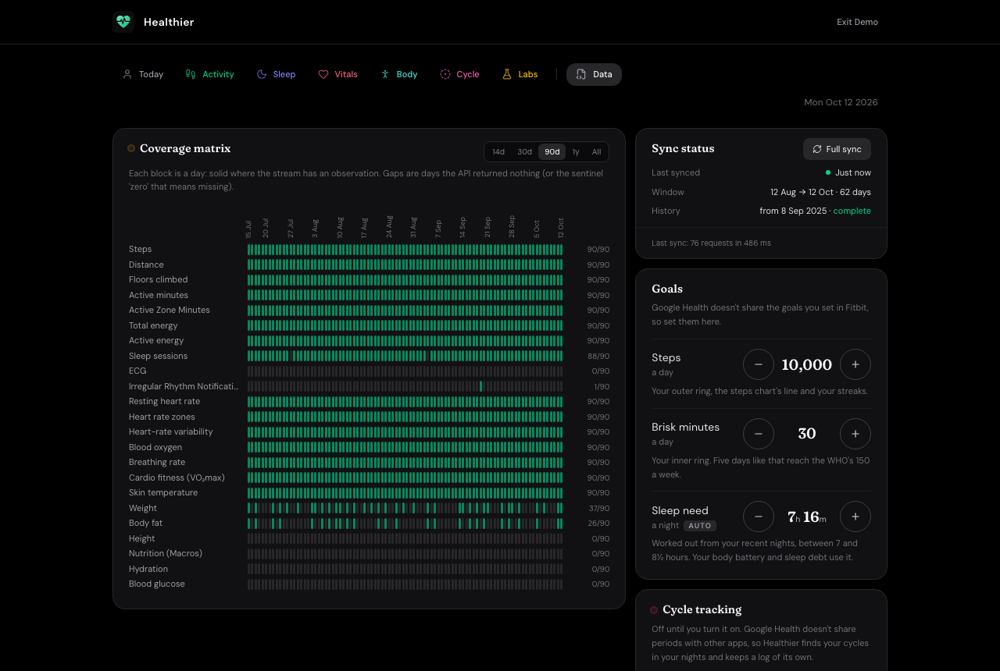<br><b>Data.</b> Every stream Healthier reads, what arrived and when, coverage day by day, your goals, and a dark or light theme.</td>
  </tr>
</table>

<table>
  <tr>
    <td width="50%" valign="top">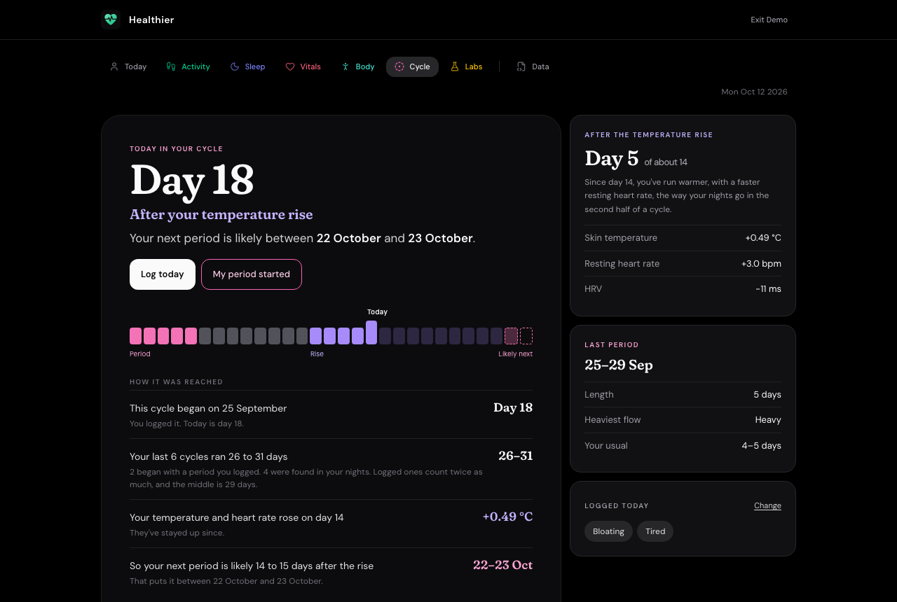</td>
    <td width="50%" valign="top"><b>Cycle.</b> For anyone who has periods, and off until it's turned on in Data. Healthier finds your cycles in your nightly heart rate, HRV, temperature and breathing, whether or not you log anything. It names the phase you're likely in, says how sure it is, shows your body through the cycle, and gives the next period as a range from your own cycles. Anything you log, kept encrypted on your own server, makes the cycles more certain. While it's on, the other pages allow for your cycle, so the usual rise in its second half isn't called unusual, unless you turn that off in Data.</td>
  </tr>
</table>

## Try the demo

Demo mode shows a year of made-up data, run through the same pipeline as real data. You can try
every page before you connect anything. It runs in your browser, so the quickest way in needs no
Google account, database or Docker. You only need Node.js 22 or later:

```sh
git clone https://github.com/cbukenya/healthier.git
cd healthier
npm install
npm run demo
```

Open the address it prints and choose **Demo mode**. Installs show the same button on their
sign-in screen, unless the owner turns it off with `DEMO_MODE=false`.

## Getting your data in

Healthier reads your data from Google Health, through Google's Health API. Anything that reaches
your Google Health account can show up in it.

- **Fitbit or Pixel Watch:** the watch syncs to the Google Health app (formerly the Fitbit app), on
  Android or iPhone. There's nothing else to set up.
- **Android apps:** apps that share through Health Connect, such as Samsung Health or Oura, can
  reach Google Health too.
- **iPhone and Apple Health:** the Google Health app for iPhone can read from Apple Health. Data
  from an Apple Watch, or from any app that writes to Apple Health, can then reach Healthier.
  1. Install the Google Health app, and sign in with the Google account you'll use for Healthier.
  2. In the app, open **Connections → Apps and services → Apple Health → Get started**. Menu names
     can differ between versions.
  3. Choose the categories to share, and allow them when iOS asks.

  Since version 5.05 (August 2026), the connection works both ways, so your Fitbit data can reach
  Apple Health as well.

Apple Health data is new to Healthier, and what arrives depends on what Google Health imports.
The **Data** page shows every stream and where it came from. If you try it, please
[open an issue](https://github.com/cbukenya/healthier/issues/new/choose) and tell us what works
and what doesn't. Leave out any health data.

**Several devices at once.** If a watch and a ring both report your nights, the **Devices and
sources** card on the Data page shows which one each reading comes from. Put the one you trust
first, or switch one off, and the change applies to all your history at once. A night the first
one missed is filled from the next, and judged only against that device's own nights. Daily
totals such as steps come already added up by Google, so for those you choose which kinds of
source count.

## Self-hosting

Requires Docker with Compose, and a Google OAuth client of your own (next section). You don't
need to clone the repository:

```sh
mkdir healthier && cd healthier
curl -fsSLO https://raw.githubusercontent.com/cbukenya/healthier/main/docker-compose.yml
curl -fsSL https://raw.githubusercontent.com/cbukenya/healthier/main/.env.example -o .env
# edit .env: Google client ID/secret, ENCRYPTION_KEY, POSTGRES_PASSWORD
docker compose up -d
```

Open http://localhost:3000 and choose **Connect Google Account**. Signing in for the first time
creates your account. If a required setting is missing, the app container exits, and
`docker compose logs app` lists what to set.

The first sign-in imports the last 62 days before the dashboard opens. Every baseline and insight
is worked out over that window. Older history, up to two years by default, then imports in the
background for the 90-day, 1-year and All views. After that, each sync fetches only the last few
days.

**Upgrading:** `docker compose pull && docker compose up -d`. Database migrations run on start.
To control when upgrades happen, pin `HEALTHIER_VERSION` in `.env` to a
[release](https://github.com/cbukenya/healthier/releases) and change it deliberately.

**Backups:** your data is in the `db-data` Docker volume.
`docker compose exec db pg_dump -U healthier healthier > backup.sql` dumps it. Keep
`ENCRYPTION_KEY` safe as well: without it, stored Google tokens can't be read and everyone has to
sign in again.

## Setting up Google access

Each install needs its own OAuth client in a Google Cloud project you own:

1. Create a project in the [Google Cloud console](https://console.cloud.google.com).
2. **APIs & Services → Library**: enable the **Google Health API**.
3. **Google Auth Platform** (formerly "OAuth consent screen"):
   - **Branding**: choose **External**, set the app name and support email.
   - **Data access**: add `openid`, `email`, `profile`,
     `googlehealth.activity_and_fitness.readonly`, `googlehealth.sleep.readonly`,
     `googlehealth.health_metrics_and_measurements.readonly`, `googlehealth.nutrition.readonly`,
     `googlehealth.ecg.readonly`, `googlehealth.irn.readonly` and
     `googlehealth.profile.readonly`.
     - The last one gives Healthier your age, for the Body page. If an install was set up before
       it, add the scope, and each user signs in again before their age appears.
     - If a scope isn't in the list, add it under **Manually add scopes** as its full URL, such as
       `https://www.googleapis.com/auth/googlehealth.profile.readonly`.
   - **Audience**: while in **Testing**, add each Google account that will sign in as a test user.
4. **Clients → Create client**: type **Web application**, with `<APP_URL>/auth/callback` as an
   authorized redirect URI, e.g. `http://localhost:3000/auth/callback`.
5. Copy the client ID and secret into `GOOGLE_CLIENT_ID` and `GOOGLE_CLIENT_SECRET` in `.env`.

**Who can sign up.** Signing in creates the account; there is no separate registration. Who gets
that far depends on the OAuth app's status:

- **Testing**: only its test users. Google expires their access every 7 days, after which the app
  asks them to reconnect.
- **In production, unverified**: anyone with a Google account, after an "unverified app" warning.
  Google caps unverified apps at 100 users, and access no longer expires weekly. Set
  `ALLOWED_EMAILS` so only the people you choose can join.
- **Verified**: no cap. The Google Health scopes are restricted, so verification includes an annual
  third-party security assessment; see [Google's app verification guide](https://developers.google.com/health/app-verification).
  A personal or family install doesn't need it.

## Configuration

All settings are environment variables, read from `.env`. [`.env.example`](.env.example) is the
reference.

| Variable | Required | Description |
| --- | --- | --- |
| `GOOGLE_CLIENT_ID` | yes | OAuth client ID from Google Cloud. |
| `GOOGLE_CLIENT_SECRET` | yes | OAuth client secret. |
| `ENCRYPTION_KEY` | yes | Encrypts Google tokens at rest. `openssl rand -base64 32`. |
| `POSTGRES_PASSWORD` | yes, with compose | Password for the bundled Postgres. `openssl rand -hex 24`. |
| `DATABASE_URL` | outside compose | Postgres connection string. Compose sets it for you. |
| `ALLOWED_EMAILS` | no | Who may sign up: addresses and/or `@domain` entries. Empty admits anyone Google lets through. |
| `HEALTHIER_VERSION` | no | Image tag to run. Default `latest`. |
| `PORT` | no | Port the app is reachable on. Default `3000`. |
| `BIND_ADDRESS` | no | Interface the port is published on. Default `0.0.0.0`; `127.0.0.1` behind a local proxy. |
| `APP_URL` | no | Public URL users open. Default `http://localhost:$PORT`. |
| `SYNC_INTERVAL_MINUTES` | no | Background sync interval per user. Default `60`; `0` turns it off. |
| `HISTORY_DAYS` | no | Days of daily history kept and imported per user. Default `730` (62–3650). |
| `DEMO_MODE` | no | Offer **Demo mode** on the sign-in screen. Default `true`; `false` hides it. |
| `SIGN_IN_NOTE` | no | Your own note under the sign-in buttons, such as how to join. Plain text, up to 600 characters; email addresses and links in it become links. Empty shows none. |

## Running behind a domain

Put a TLS-terminating reverse proxy (Caddy, Traefik, nginx, or a Cloudflare Tunnel) in front of
the app, then:

- set `APP_URL=https://your.domain`, and add `https://your.domain/auth/callback` as a redirect URI
  on the OAuth client;
- set `BIND_ADDRESS=127.0.0.1` if the proxy runs on the same machine. Ports published by Docker
  bypass host firewalls such as `ufw`, so otherwise the app is also reachable over plain HTTP.

Session cookies are marked `Secure` automatically when `APP_URL` is https.

Over https, Healthier can also be installed as an app, with its own icon and window and no
browser bars. Chrome on Android and on computers offers to install it; on an iPhone, it's Share,
then Add to Home Screen. Browsers only offer this over https, or on `localhost`.

## Contributing

Healthier gets better the more people look at their own data with it and say what they find. Here
are some ways to help:

- **Insights:** check the arithmetic, sharpen a card's words, or propose a new card along with the
  research behind it.
- **Labs:** improve an experiment, or bring a new one.
- **Translations:** every word lives in one file per language, in [`src/locales/`](src/locales).
- **Reports:** tell us what's unclear, wrong or missing, especially from iPhone and Android setups
  we haven't seen.

[CONTRIBUTING.md](CONTRIBUTING.md) explains how.

## Development

See [CONTRIBUTING.md](CONTRIBUTING.md) for setup, checks and the release process. In short:

```sh
npm install
docker compose -f docker-compose.yml -f docker-compose.dev.yml up -d db   # Postgres on localhost:5432
npm run dev        # http://localhost:3000 with hot reload; reads .env
npm test
```

### How it fits together

- `server.ts` and `server/`: the Express app. It covers:
  - Google OAuth (`auth.ts`) and sign-up control (`access.ts`);
  - the JSON API (`api.ts`) and background sync (`sync.ts`);
  - Postgres access and migrations (`db.ts`, `repo.ts`).
- `src/pipeline/`: fetches and normalises Google Health data.
  - `incremental.ts` is the sync engine: what to fetch, and how per-stream daily rows are stored and
    reassembled. It runs on the server for live data and in the browser for demo mode.
  - `insights/` is the insight engine. Each page's cards are in `insights/cards/`.
  - `labs.ts` holds the arithmetic for Labs.
  - `demo.ts` makes up the demo person.
- `src/locales/`: every word the app shows, one file per language.
- `src/`: the React dashboard.

How it works and why: [docs/ARCHITECTURE.md](docs/ARCHITECTURE.md).

## Roadmap

Planned work is tracked as [milestones](https://github.com/cbukenya/healthier/milestones) on GitHub.
Ideas and bug reports are welcome as [issues](https://github.com/cbukenya/healthier/issues).

## Security

Please report vulnerabilities privately; see [SECURITY.md](SECURITY.md).

## License

[GNU Affero General Public License v3.0](LICENSE). You may use, modify and self-host Healthier
freely. If you run a modified version as a service for others, you must make your source code
available to its users under the same license.

The body battery's figures are silhouettes from [Vecteezy](https://www.vecteezy.com).
